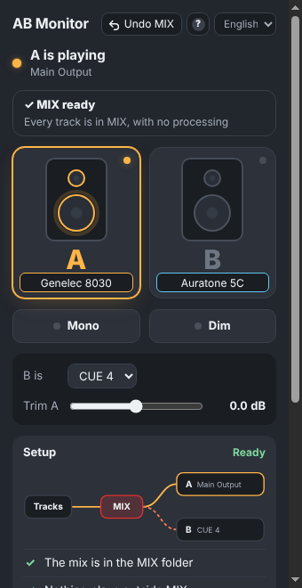
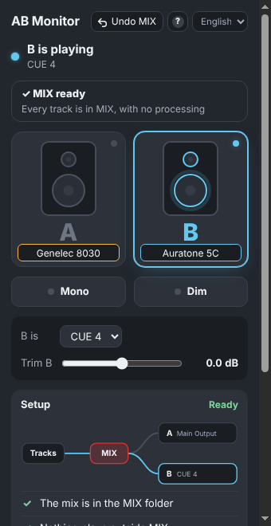

# AB Monitor for LUNA

Check your mix on a second pair of speakers with one click, no extra hardware. AB Monitor
switches LUNA between your main monitors and a second pair (a small mono speaker, earbuds, a
car-style pair), with mono, dim and both pairs matched in level, on any audio interface.

  
  

## Features

- **A and B.** A is LUNA's Main Output; B is a cue bus (CUE 1-4) that LUNA's audio settings
  send to other outputs. Pressing A or B mutes one and unmutes the other, as one undo step.
- **Prepare MIX.** One click does what you would otherwise do by hand: every track and bus
  except the Main Output and the cues goes into a new red summing folder, MIX (folders go in
  with their contents), and every process on MIX is removed: console, summing, tape and
  inserts. Tracks routed by hand to a bus keep that route.
- **Undo MIX** puts back only what Prepare did: the tracks come out of MIX to where they were,
  in their order and with their routes, and MIX is deleted. The rest of LUNA's history is left
  alone.
- **B follows the cue you pick** under "B is". Pressing B sends MIX to that cue (0 dB,
  post-fader, stereo) and mutes any other send to it, so nothing plays twice.
- **Mono** sums both pairs to mono; **Dim** lowers both by 20 dB; a **trim** per pair matches
  their levels. They use the buses' trim, never your faders or automation.
- **Your own names.** Double-click A or B (or its pencil) and type a name, such as Genelec or
  Auratone. The names are kept for every session.
- **Setup panel** with a signal-flow diagram and a check for each step (MIX, tracks outside it,
  plugins on it, the cue send), each with its own fix button.
- **7 languages:** English, Español, Català, Français, Deutsch, Italiano and Português. The
  first time it follows the system language; the selector at the top changes it.

**MIX must stay clean:** no plugin, console, tape emulation or effect on it, so the mix sounds
exactly as before. Prepare MIX removes them, and a check warns you if one appears later.

## Setup

1. In LUNA's audio settings, assign one cue (CUE 1-4) to the outputs your B speakers are
   connected to. You do this once.
2. Open a session and choose **Add Ons > Windows > AB Monitor**.
3. Pick that cue under **B is**, then press **Prepare MIX**.

## Support

If something does not work as expected, Alt-click the version number at the top of the window:
it copies a short report to paste in a message to fedetrillo@gmail.com.

## Install

Requires LUNA 3.1.2 or later. Install it from LUNA's Add On marketplace, or download
`ab-monitor.lunaaddon` from the latest release and double-click it.

## En español

Cambia entre dos pares de altavoces desde LUNA, con cualquier interfaz: A es el Main Output y
B un CUE enviado a otras salidas. Mono, Dim, trim por par y tus propios nombres para cada par.
Con un clic, Preparar MIX mete todas las pistas en una carpeta MIX roja sin ningún proceso
(plugins, consola ni cinta), y Deshacer MIX lo devuelve todo a como estaba. En 7 idiomas.

The first time it opens, it asks for your language and then a short guide walks you through the
window in it; the **?** button brings it back whenever you need it.

## Licence

Copyright (c) 2026 Fede Trillo. All rights reserved. Free to install and use in LUNA; the code
may not be copied, modified or redistributed. See [LICENSE](LICENSE). The bundled LUNA Builder
SDK is Universal Audio's, under the Apache License 2.0: see
[THIRD_PARTY_NOTICES.md](THIRD_PARTY_NOTICES.md).

Contact: fedetrillo@gmail.com
